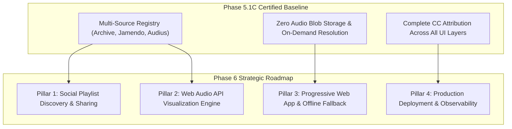

# SOUNDWAVE — Phase 6: Transition & Strategic Roadmap Report

**Project:** SOUNDWAVE — Multi-Source Music Playlist & Audio Platform  
**Phase:** 6 — Transition & Next-Phase Roadmap Proposal  
**Date:** November 4, 2026  
**Status:** READY FOR AUTHORIZATION & EXECUTION  
**Repository:** `https://github.com/rk0802p/music_playlist`  
**Current Baseline:** Phase 5.1C Certified (141/141 Backend Tests Passing, 26/26 Re-Verification Checks Passing)

---

## 1. Executive Context & Transition Foundation

With the completion and formal acceptance of Phase 5.1C, SOUNDWAVE has achieved total operational stabilization:
- **Audio Delivery Integrity:** Zero audio blobs stored in MongoDB; 100% direct streaming with on-demand resolution and progressive alternative fallback.
- **Provider Architecture:** Internet Archive (public domain / live recordings), Audius (decentralized streams), Jamendo (fully parsed Creative Commons licensing engine with active attribution backlinks across dock, queue, search, and playlists), Spotify (oEmbed metadata and user OAuth lifecycle), and JioSaavn (strictly quarantined as `DEV-SAAVN` with 403 production resolution guardrails).
- **Core Security:** Strict CORS allowlists, fail-fast JWT startup validation, tamper-proof supertest ownership isolation, and explicit diagnostic readyState reporting.
- **Visual Design & UX:** The glassmorphic design language, 18 canonical homepage tracks, and responsive breakpoints (390px, 768px, 1280px) are fully verified and protected against regressions.

Having surveyed the repository and `docs/` directory, no pre-existing Phase 6 task brief is present. This report therefore establishes the evidence-based roadmap and architectural blueprint for **SOUNDWAVE Phase 6: Social Discovery, Ambient Audio Visualization & Production Hardening**.

---

## 2. Proposed Phase 6 Strategic Roadmap

---

## 3. Detailed Work Packages for Phase 6

### Pillar 1: Social Playlist Discovery & Shareable Mixtapes
1. **Public Explore & Discover Feed (`/explore`):**
   - Provide a curated view of user-created public playlists (`isPublic: true`).
   - Allow filtering by vibe, genre tags, and music providers.
2. **One-Click Shareable Links & Dynamic Open Graph Cards:**
   - Generate shareable URLs (`/playlist/:id` or short-hash links) enabling unauthenticated visitors to preview and stream public mixtapes directly.
   - Dynamic meta tags for Twitter Cards and Open Graph previews showing playlist name, track count, and cover art.
3. **Playlist Forking / Cloning:**
   - Allow authenticated users to "Fork" or "Save a Copy" of any public playlist into their private collection with a single click.

### Pillar 2: Real-Time Web Audio API Visualization Engine
1. **Interactive Glass Visualizer:**
   - Connect the HTML5 audio element to a Web Audio API `AudioContext` and `AnalyserNode`.
   - Render a reactive audio frequency canvas (ambient waveform, floating particles, or spectral ring) inside the floating player dock or a full-screen "Focus / Ambient Mode".
2. **Audio-Reactive Theme Accents:**
   - Synchronize CSS gradient pulses and vinyl glow intensities to real-time RMS audio energy without impacting UI performance or battery life.
3. **Accessibility Safeguard:**
   - Strictly respect `prefers-reduced-motion` media queries by disabling canvas animations when motion reduction is requested.

### Pillar 3: Offline Experience & Progressive Web App (PWA) Enhancements
1. **Service Worker Metadata & Asset Caching:**
   - Enhance `/sw.js` to precache application shell, icons, and fonts for immediate offline startup.
   - Cache user playlist JSON structures and metadata in IndexedDB / CacheStorage so users can review their mixtapes while offline.
2. **Honest Offline State Handling:**
   - Gracefully display offline indicators when the network drops; clearly flag tracks requiring remote network streaming without crashing or hanging the player.
3. **Desktop & Mobile Installability:**
   - Add a verified `manifest.json` with multi-resolution icons, standalone display mode, and shortcut actions (`/search`, `/library`).

### Pillar 4: Production Observability & Deployment Hardening
1. **Vercel Production Alignment:**
   - Verify deployment parity between local development and production backends (`https://music-playlist-nine.vercel.app`) and frontends (`https://music-playlist-pp8l.vercel.app`).
   - Validate environment variable configurations (`JAMENDO_CLIENT_ID`, `JWT_SECRET`, `MONGO_URI`, `FRONTEND_URL`, `ALLOWED_ORIGINS`).
2. **Structured Logging & Health Telemetry:**
   - Add structured JSON logging to Express controllers for auditability.
   - Monitor circuit breaker trip events across external provider queries (Internet Archive, Audius, Jamendo) to detect upstream outages automatically.

---

## 4. Phase 6 Execution Readiness & Entry Criteria

1. **Working Tree Cleanliness:** Complete (all Phase 5.1C fixes and reports committed).
2. **Test Automation Baseline:** 141 backend tests + 26 browser integration checks passing at 100%.
3. **No Regressions:** Homepage 18 Spotify tracks preserved; Track 12 honestly unavailable; Jamendo CC attribution active.
4. **Authorization Gate:** Phase 6 implementation can commence immediately upon user confirmation of the preferred pillar or full execution scope.
